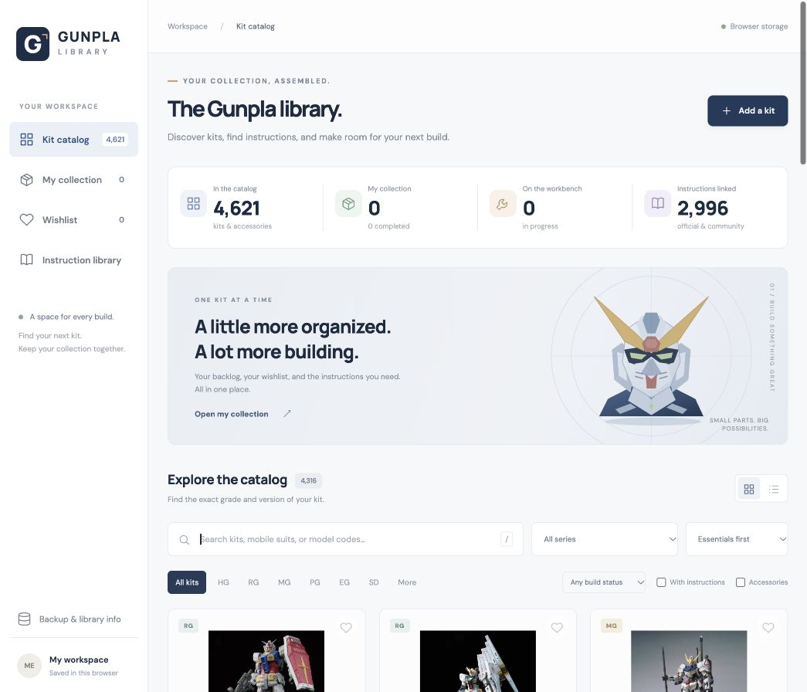

# Gunpla Library

A clean English catalog and personal collection tracker. Plain HTML, CSS, and JavaScript; no dependency installation or build step.

[Open the live app](https://gunpla-codex-theta.vercel.app/)



## Use

- Search by kit name, grade, series, or model code. `Nu` also finds `ν`.
- Click **Collect** to mark a kit owned, then choose **Unbuilt**, **Building**, or **Completed**.
- Click the heart to add a kit to the wishlist independently of ownership.
- Open a kit for source information and exact-version instruction links.
- **Add a kit** creates a personal entry when the catalog is missing a release.
- **Backup & library info**, also accessible through **Sources & coverage** in the footer, exports and imports your personal data.

## Shared collection

When Supabase is configured, all visitors see the same collection and wishlist. Viewing needs no sign-in. The two approved editors sign in through an email link. PostgreSQL row-level security blocks everyone else from writing, including signed-in accounts that are not on the editor list. Editor email addresses are private and must not be committed to this public repository.

Updates are saved online and picked up by other open browsers within about 15 seconds, or when they return to the tab. Saves use revision checks and reapply only the fields changed by that action, preserving unrelated concurrent edits. A connection error disables editing instead of quietly saving a different local copy.

Until Supabase is configured, the original browser-storage mode stays available. Its data remains under `gunpla-library.v1` and is never replaced by a cloud snapshot. Once connected, an approved editor can use **Backup & library info → Publish my browser collection** to merge that browser's earlier collection into the public shared library. The original browser copy is preserved. You can also export and import JSON backups.

### Enable sharing on Vercel

1. Create or select a Supabase project and run `supabase/migrations/001_shared_collection.sql` once in its SQL editor. Do not rerun this initial migration on an existing setup.
2. Add the two editor emails privately in the Supabase SQL editor:

   ```sql
   insert into public.gunpla_editors (email)
   values (lower('YOUR_EMAIL')), (lower('YOUR_GIRLFRIEND_EMAIL'))
   on conflict (email) do nothing;
   ```

3. In Supabase **Authentication → URL Configuration**, set the site URL and an allowed redirect URL to `https://gunpla-codex-theta.vercel.app/`. Email authentication must be enabled. Sign-in uses Supabase's standard magic-link email template.
4. Configure email delivery for both editors. Supabase's default mail service restricts recipients; use a configured SMTP provider when the two addresses are not allowed by that default service. The app does not send invitations during setup.
5. Add these production environment variables in Vercel and redeploy:
   - `SUPABASE_URL`: the project's HTTPS URL.
   - `SUPABASE_PUBLISHABLE_KEY`: its publishable key. A legacy **anon** key can instead be supplied as `SUPABASE_ANON_KEY`. Never put a service-role or secret key here.
6. Open the website. It should say **Shared collection · view only**. Sign in as each approved editor and verify they can edit. An unapproved account must remain a viewer. Publish the old browser collection only when ready to make it publicly viewable.

The Vercel `/api/config` endpoint returns only the public project URL and public key. Row-level security enforces access in the database; hiding buttons is not the access control. No server secret is required. The Supabase browser SDK is pinned to version 2.118.0 and loaded from jsDelivr only in shared mode.

Official references: [Supabase RLS](https://supabase.com/docs/guides/database/postgres/row-level-security), [email sign-in](https://supabase.com/docs/guides/auth/auth-email-passwordless), and [API keys](https://supabase.com/docs/guides/api/api-keys).

### Verify database access before using real data

Check the configured database with four clients: signed out, editor one, editor two, and a third unapproved account. All may read `gunpla_library`. Only the two editor clients may update its `state` and `revision`; none of the browser clients may insert or delete the singleton row or modify `gunpla_editors`. Each authenticated client can see only its own membership row, and signed-out clients cannot read the editor table. Run simultaneous edits from the two editors and confirm both changes survive.

The Node tests exercise synchronization, permission guards, key filtering, and conflict retries with a simulated database. They do not replace these live database-policy and email-delivery checks.

## Source coverage

Snapshot: 16 October 2026. Includes 3,816 Bandai Spirits Gunpla category records, Gundam-related entries from the official Bandai manual library, and additional Dalong records. After matching, the snapshot contains 4,621 catalog records and 2,996 linked instructions. Counts include accessories. This is broad coverage, not a certified complete list of every historical, regional, or limited release.

Official manual links open Bandai's kit detail page; community links open Dalong's information page with the manual section. Instructions are linked on their source websites and are not rehosted. Some Japanese source names and unclassified series are retained. Exact normalized Japanese names are matched; uncertain matches remain separate, so some duplicate releases may remain.

Sources:
- https://www.bandaispirits.co.jp/products/search/result.php?category=1
- https://manual.bandai-hobby.net/
- https://www.dalong.net/reviews/about_e.htm

Images load from Bandai where available and use a placeholder when unavailable. Fonts load from Google Fonts with a system fallback. The geometric header illustration is an original SVG.

## Run locally

From this folder, run `npm run dev` and open `http://localhost:4173`.
Alternatively: `python3 -m http.server 4173 --directory dist`.

Run checks with `npm test` (Node 18+). The source checks cover backup validation, URL safety, filters, and catalog integrity.

## Updating catalog data

The hosted app does not automatically refresh its catalog. The `scripts` folder contains the source importers used for this snapshot. They cache fetched pages under `scripts/cache/`. The official importer currently follows the source pagination limits observed for this snapshot; recheck those limits when updating. Run the official importer before the community importer. These scripts require Python 3 and internet access, and do not read your collection.
